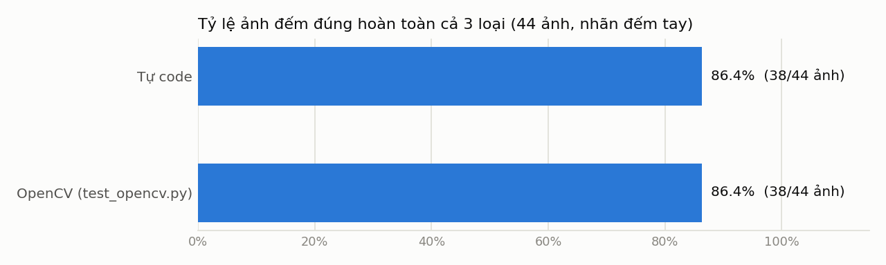
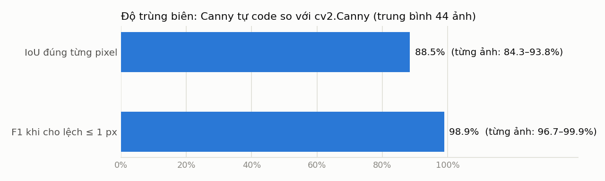
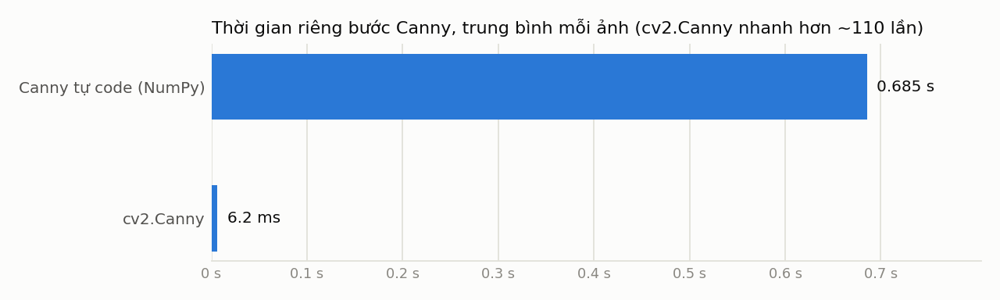
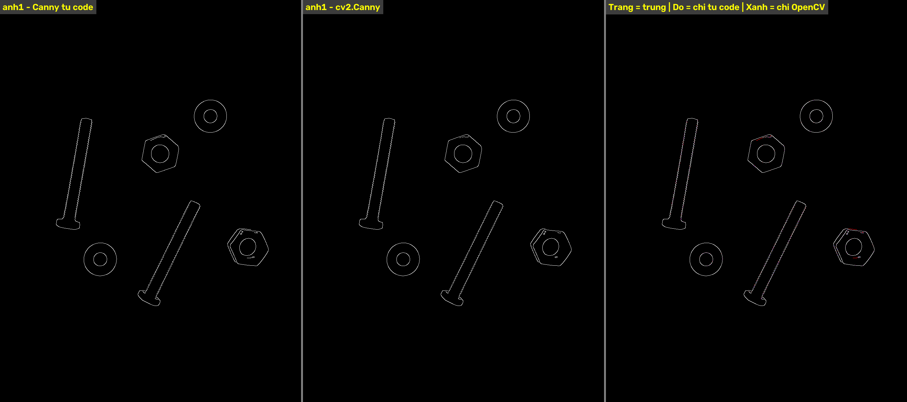

# So sánh Canny tự code và OpenCV trong bài toán đếm linh kiện

Đề tài: **Phát hiện biên ảnh và ứng dụng**. Hệ thống đếm và phân loại bu-lông, vòng đệm và đai ốc dựa trên biên Canny. Repo này so sánh hai bản cài đặt của cùng một hệ thống:

1. **Tự code** (`tu_code/`): Canny, tách vật và trích đặc trưng tự cài bằng NumPy. Đây là bản sao của project bài tập lớn.
2. **OpenCV** (`test_opencv.py`): đi đúng các bước như bản tự code, nhưng bước nào OpenCV có hàm sẵn thì dùng hàm đó.

Hai bản **dùng chung luật phân loại** (`tu_code/classifier.py`) và **cùng bộ tham số** (`tu_code/default.json`). Vì vậy mọi khác biệt trong kết quả chỉ đến từ phần cài đặt, không đến từ cách chọn luật.

## Kết quả trên 44 ảnh có nhãn đếm tay

| | Tự code | OpenCV |
|---|---|---|
| Đếm đúng hoàn toàn cả 3 loại | **38/44 (86.4%)** | **38/44 (86.4%)** |
| Ảnh linh kiện rời nhau | 38/39 (97.4%) | 38/39 (97.4%) |
| Ảnh linh kiện chồng/chạm nhau | 0/5 | 0/5 |
| Bu-lông / vòng đệm / đai ốc đếm được (thật: 90 / 85 / 87) | 87 / 77 / 73 | 87 / 77 / 73 |
| Thời gian trung bình mỗi ảnh (cả pipeline) | khoảng 1.17 s | khoảng 0.022 s |

Hai bản cho số đếm **giống hệt nhau ở cả 44 ảnh**. Chúng sai cùng 6 ảnh, gồm anh12 và anh40–anh44 (xem mục [Giới hạn](#giới-hạn)).



### Độ trùng biên: Canny tự code so với cv2.Canny

Hai bản Canny chạy trên **cùng một ảnh xám**, với cùng tham số. A là biên của bản tự code, B là biên của cv2.Canny.

| Chỉ số | Trung bình | Thấp nhất – cao nhất |
|---|---|---|
| IoU đúng từng pixel, \|A ∩ B\| / \|A ∪ B\| | 88.5% | 84.3% – 93.8% |
| F1 khi cho lệch ≤ 1 px (lân cận 3×3) | 98.9% | 96.7% (anh41) – 99.9% |
| Precision / recall khi cho lệch ≤ 1 px | 98.7% / 99.2% | |

Gần như toàn bộ biên trùng nhau khi cho phép lệch 1 pixel. Phần không trùng chính xác chủ yếu là biên bị dịch sang pixel bên cạnh. Lý do là bản tự code dùng một kernel đạo hàm Gauss 7×7, còn OpenCV làm mờ Gauss rồi mới dùng Sobel 3×3.





Riêng bước Canny, cv2.Canny nhanh hơn khoảng 100 lần (đo được khoảng 0.69 s so với 6 ms mỗi ảnh). Lý do là OpenCV viết bằng C++ có tối ưu, còn bản tự code chạy bằng Python/NumPy. Thời gian thay đổi một chút giữa các lần chạy.

Ảnh so sánh biên nằm trong [`so_sanh/bien/`](so_sanh/bien/). Trong đó, trắng là chỗ hai bản trùng nhau, đỏ là chỗ chỉ bản tự code có biên, xanh dương là chỗ chỉ OpenCV có biên.



## Các bước xử lý

| Bước | Bản tự code (`tu_code/`) | Bản OpenCV (`test_opencv.py`) |
|---|---|---|
| 1. Đọc ảnh, đổi sang ảnh xám | Pillow + nhân ma trận RGB | `cv2.imdecode` + `cv2.cvtColor` |
| 2. Phát hiện biên Canny | `canny.py` (Gauss, gradient, NMS, ngưỡng trễ) | `cv2.GaussianBlur` + `cv2.Canny` |
| 3. Đóng biên | `morphology.close` | `cv2.morphologyEx(MORPH_CLOSE)` |
| 4. Loang nền từ mép ảnh | `fill_enclosed_regions` | `cv2.floodFill` |
| 5. Tách vật, lọc vật | BFS `connected_components` | `cv2.connectedComponentsWithStats` |
| 6. Tâm, độ thuôn | Ma trận hiệp phương sai | `cv2.moments` |
| 7. Biên ngoài của vật | `morphology.erode` | `cv2.erode` |
| 8. Tìm lỗ | BFS `connected_components` | `cv2.connectedComponentsWithStats` |
| 9. `radial_cv`, `hex_score` | Công thức riêng | Giữ nguyên công thức (OpenCV không có hàm tương ứng) |
| 10. Phân loại | `classifier.classify` | Dùng chung `classifier.classify` |

Ngưỡng Canny của bản tự code đặt trên thang 0–255, chuẩn hóa theo gradient lớn nhất của từng ảnh. cv2.Canny dùng đơn vị gradient tuyệt đối, nên ngưỡng được quy đổi: `ngưỡng_cv2 = T / 255 × gradient_lớn_nhất`.

Ở bước 5, có thêm hai bộ lọc vật:
- Vật nằm cách mép ảnh dưới 3 px được coi là chạm mép và bị loại.
- Vùng chiếm dưới 8% khung bao của chính nó được coi là sợi biên hở, không phải vật.

## Cách chạy

Yêu cầu: Python 3, `opencv-python`, `numpy`, `pillow`, `matplotlib`. Repo đã được thử với Python 3.13, OpenCV 5.0, NumPy 2.4.

```bash
pip install opencv-python numpy pillow matplotlib

# Chạy bản OpenCV, lưu ảnh kết quả từng bước vào output/
python test_opencv.py dataXuLiAnh/      # cả thư mục
python test_opencv.py dataXuLiAnh/anh1.jpg   # một ảnh

# So sánh hai bản trên 44 ảnh, ghi kết quả vào so_sanh/
python so_sanh.py
```

`test_opencv.py` ghi kết quả vào `output/`:
- `<ảnh>_steps.png`: 6 ô, gồm ảnh gốc, Canny, đóng biên, vật thể, lỗ, kết quả.
- `<ảnh>_result.png`: ảnh kết quả có nhãn.
- `objects.csv`: đặc trưng từng vật.
- `counts.csv`: số đếm từng ảnh, kèm nhãn thật.

`so_sanh.py` ghi kết quả vào `so_sanh/`:
- `bang_dem.csv`: số đếm thật, của bản tự code và của OpenCV cho từng ảnh, kèm độ trùng biên và thời gian Canny.
- `tong_hop.json`: toàn bộ chỉ số.
- 3 biểu đồ và các ảnh so sánh biên trong `bien/`.

## Cấu trúc thư mục

```
dataXuLiAnh/      44 ảnh linh kiện (anh1.jpg … anh44.jpg)
tu_code/          bản sao pipeline tự code từ project bài tập lớn
  counts.json     nhãn đếm tay của 44 ảnh
  default.json    tham số dùng chung cho cả hai bản
test_opencv.py    bản dùng thư viện OpenCV
so_sanh.py        script so sánh hai bản
so_sanh/          kết quả so sánh (csv, json, biểu đồ, ảnh biên)
```

## Giới hạn

- **Linh kiện chồng hoặc chạm nhau** (anh40–anh44): bước loang nền gộp các vật dính nhau thành một vùng, nên cả hai bản đều đếm sai. Muốn tách được cần thêm một bước khác, ví dụ biến đổi khoảng cách kết hợp watershed.
- **Linh kiện bị mép ảnh cắt** (anh12): theo quy ước, vật chạm mép ảnh không được đếm. Nhãn tay vẫn đếm bu-lông bị cắt này, nên ảnh này được tính là sai.
- **Ngưỡng Canny 30/70** được chọn sau khi thử trên chính 44 ảnh này. Với ngưỡng cũ 40/90, viền ngoài của một số đai ốc phản sáng bị hở. Các con số ở trên vì vậy có thể lạc quan hơn so với khi chạy trên ảnh mới.
